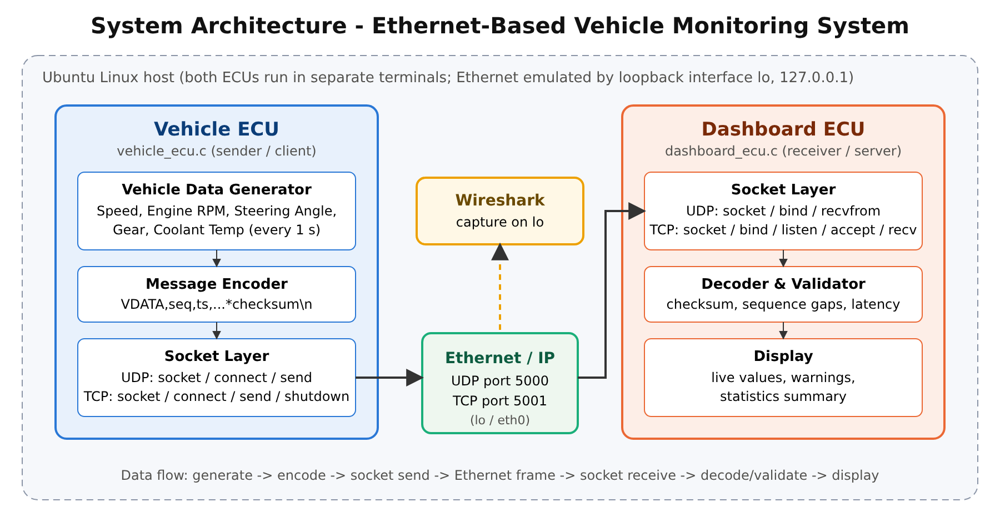
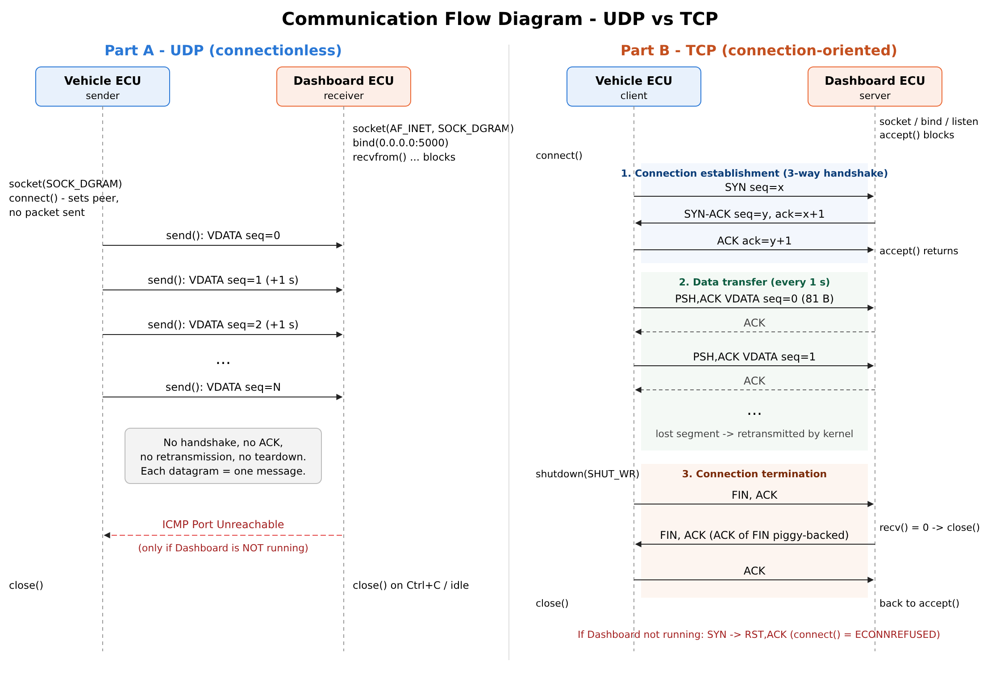

# Ethernet-Based Vehicle Monitoring System using Linux Socket Programming

A **Vehicle ECU** periodically generates vehicle data (speed, engine RPM, steering angle, plus gear and coolant temperature) and transmits it over Ethernet. A **Dashboard ECU** receives, validates and displays it. Both are written in C with POSIX sockets and support **UDP** and **TCP**. The traffic is analysed with **Wireshark**.

| | |
|---|---|
| **Student** | {{Atharva Bobade}} |
| **Roll No. / Course** | {{23310014}} |
| **Platform** | Ubuntu 24.04 LTS, GCC 13.3, Wireshark 4.2 |

---

## Repository structure

```
README.md
docs/
├── Design_Document.pdf        architecture, message format, flow diagrams, software design
├── Validation_Report.pdf      Wireshark analysis + all 5 validation scenarios with results
├── TCP_UDP_Comparison.pdf     comparative study (reliability, speed, overhead, ...)
├── images/                    architecture & flow diagrams, charts
└── source/                    Markdown sources of the PDFs
src/
├── vehicle_ecu.c              Vehicle ECU (sender / TCP client)
├── dashboard_ecu.c            Dashboard ECU (receiver / TCP server)
├── vehicle_protocol.h         shared message format, encoder/decoder, checksum
└── Makefile
screenshots/                   console + Wireshark (tshark) evidence for every scenario
wireshark/
├── tcp_capture.pcapng         Scenario 1 - TCP: handshake, data, termination
├── udp_capture.pcapng         Scenario 1 - UDP: 15 datagrams
└── scenarios/                 extra captures (receiver down, restart, 10-min run, wrong IP)
logs/                          full console output of every test run
```

## System architecture



## Communication flow



## Message format

One ASCII line per sample, readable directly in Wireshark:

```
VDATA,seq=0,ts=1794847196895182,speed=0.0,rpm=823,steer=1.4,gear=0,temp=24.8*7A\n
```

`seq` detects loss and re-ordering, `ts` measures latency, `*7A` is an XOR checksum, and `\n` frames messages on the TCP byte stream.

## Build

```bash
sudo apt install build-essential wireshark     # once
cd src
make
```

## Run (two terminals)

**Part A - UDP**
```bash
# Terminal 1                          # Terminal 2
./dashboard_ecu -m udp -p 5000        ./vehicle_ecu -m udp -i 127.0.0.1 -p 5000
```

**Part B - TCP**
```bash
# Terminal 1                          # Terminal 2
./dashboard_ecu -m tcp -p 5001        ./vehicle_ecu -m tcp -i 127.0.0.1 -p 5001
```

Stop either side with **Ctrl+C**; both print a statistics summary. Shortcuts: `make run-udp-dashboard`, `make run-udp-vehicle`, `make run-tcp-dashboard`, `make run-tcp-vehicle`.

### Options

| vehicle_ecu | | dashboard_ecu | |
|---|---|---|---|
| `-m udp\|tcp` | protocol | `-m udp\|tcp` | protocol |
| `-i ip` | Dashboard IP (default 127.0.0.1) | `-b ip` | listen address (default 0.0.0.0) |
| `-p port` | port (default 5000) | `-p port` | port (default 5000) |
| `-n count` | messages, 0 = forever | `-c count` | stop after N messages |
| `-t ms` | period (default 1000) | `-T s` | stop after N idle seconds |
| `-r n` | TCP connect attempts (default 5) | `-q` | quiet (summary only) |
| `-q` | quiet | | |

## Wireshark analysis

1. Start Wireshark and capture on **Loopback: lo**.
2. Display filter `udp.port == 5000` or `tcp.port == 5001`.
3. Or open the captures in `wireshark/` directly.

| UDP - identified | TCP - identified |
|---|---|
| Source / Destination IP: 127.0.0.1 → 127.0.0.1 | SYN (frame 1) |
| Source port: ephemeral (42069), Destination port: 5000 | SYN-ACK (frame 2) |
| Payload: `VDATA,seq=0,...*7A` (80 bytes) | ACK (frame 3) |
| No handshake, no ACKs, no teardown | Data: PSH,ACK + ACK per message (frames 4-33) |
| | Termination: FIN,ACK → FIN,ACK → ACK (frames 34-36) |

## Validation results

| # | Scenario | UDP | TCP |
|---|---|---|---|
| 1 | Normal communication (15 msgs) | 15/15 delivered, avg 0.18 ms | 15/15 delivered, avg 0.14 ms |
| 2 | Dashboard ECU not running | Keeps sending; ICMP Port Unreachable reported | SYN → RST; 3 retries, then clean exit |
| 2b | Dashboard restarted mid-run | Resumes automatically | `EPIPE` → automatic reconnect |
| 3 | Continuous 10 min (600 msgs) | 600/600, 0 errors, no drift | 600/600, 0 errors, 0 retransmissions |
| 4 | Invalid IP | Malformed: rejected. Unreachable: **undetectable** | Malformed: rejected. Unreachable: timeout + error |
| 5 | Burst of 50 000 msgs | **80.3 %** delivered (no flow control) | **100 %** delivered |

Details, screenshots and analysis: [`docs/Validation_Report.pdf`](docs/Validation_Report.pdf).

## TCP vs UDP (summary)

| Parameter | TCP | UDP |
|---|---|---|
| Reliability | Guaranteed, ordered delivery | Best effort; loss is silent |
| Speed | Handshake + queuing latency under load | Lowest latency, never blocks |
| Overhead | 36 frames / 3 636 B for 15 msgs | 15 frames / 1 873 B for 15 msgs |
| Error handling | Retransmission, explicit socket errors | Checksum only; application must detect loss |
| Connection | 3-way handshake + FIN termination | None |
| Typical use | OTA updates, diagnostics (DoIP), config, logs | Cyclic sensor data (SOME/IP events), streaming, discovery |

Full study: [`docs/TCP_UDP_Comparison.pdf`](docs/TCP_UDP_Comparison.pdf).
