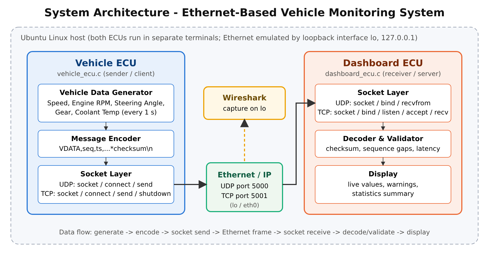
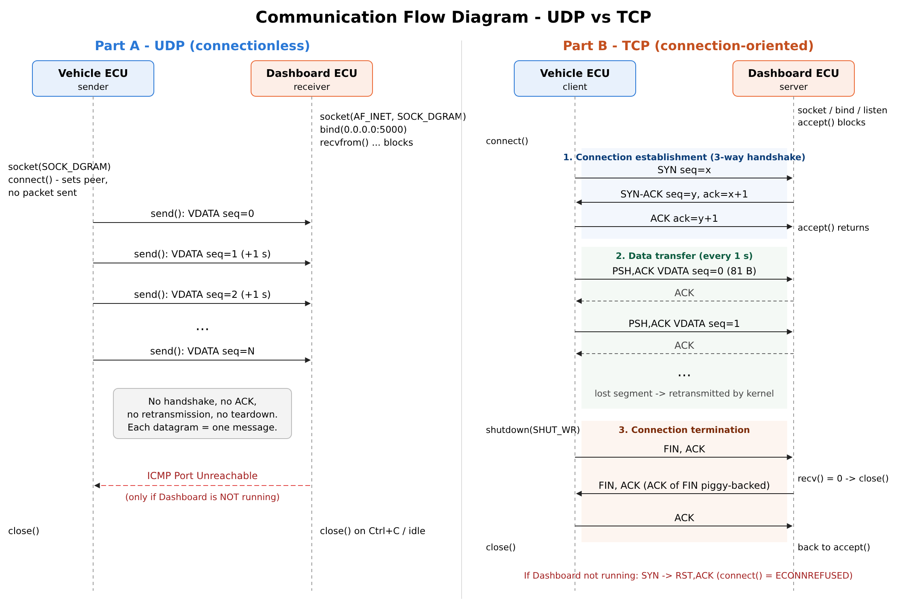

<div class="meta">

| | |
|---|---|
| **Student** | {{STUDENT_NAME}} |
| **Roll No. / Course** | {{ROLL_NO}} |
| **Repository** | {{REPO_URL}} |
| **Platform** | Ubuntu 24.04 LTS, GCC 13.3, Wireshark/TShark 4.2.2 |
| **Date** | {{DATE}} |

</div>

## 1. Introduction

Modern vehicles exchange information between Electronic Control Units (ECUs) over automotive Ethernet. Higher-level automotive protocols such as SOME/IP and DoIP are built on top of the same TCP/IP socket interface that every Linux application uses. This project implements that foundation directly.

Two applications are developed in C using the Berkeley/POSIX socket API:

- **Vehicle ECU** (`vehicle_ecu`) generates vehicle data periodically (every 1 s by default) and transmits it over Ethernet.
- **Dashboard ECU** (`dashboard_ecu`) receives the data, validates it, and displays it to the user.

Both applications support **UDP** (Part A) and **TCP** (Part B), selected at run time with `-m udp|tcp`. They run on the same Ubuntu machine in two terminals and communicate over the loopback interface (`lo`, 127.0.0.1). The same binaries also work between two machines on a real Ethernet LAN by passing the Dashboard's IP address with `-i`.

## 2. Requirements

| ID | Requirement | How it is met |
|---|---|---|
| FR-1 | Vehicle ECU shall periodically generate vehicle data | Drive-cycle model, period set with `-t` (default 1000 ms) |
| FR-2 | Data shall include Vehicle Speed, Engine RPM and Steering Angle | Mandatory fields `speed`, `rpm`, `steer` |
| FR-3 | Additional signals may be added | Extra signals `gear` and `temp` (coolant), plus `seq` and `ts` for diagnostics |
| FR-4 | Transmit data using UDP sockets | `-m udp`: `socket(SOCK_DGRAM)` + `send()` |
| FR-5 | Transmit data using TCP sockets with connection establishment, data transfer and termination | `-m tcp`: `connect()` (3-way handshake), `send()`, `shutdown()` + `close()` (FIN exchange) |
| FR-6 | Dashboard ECU shall receive, process and display data | `recvfrom()` / `accept()` + `recv()`, decoding, validation, formatted output |
| FR-7 | Both applications run on the same Ubuntu host in separate terminals | Default IP 127.0.0.1; UDP and TCP use separate ports |
| NFR-1 | Robust error handling (receiver absent, invalid IP, peer loss) | IP validation, connect timeout, retries, auto-reconnect, ICMP error reporting |
| NFR-2 | Reliability must be measurable | Sequence numbers, checksum, latency measurement and end-of-run statistics |
| NFR-3 | Stable timing over long runs | Absolute-deadline scheduling with `clock_nanosleep(CLOCK_MONOTONIC, TIMER_ABSTIME)`, so the period does not drift |

## 3. System Architecture



The architecture follows the required *Vehicle ECU - Ethernet - Dashboard ECU* structure. Each ECU has three layers:

| Layer | Vehicle ECU (sender) | Dashboard ECU (receiver) |
|---|---|---|
| Application | Vehicle data generator (drive-cycle model) | Display: live values, LEFT/RIGHT steering, over-rev / over-temperature warnings, statistics |
| Presentation | Message encoder: `vp_encode()` builds the ASCII frame and checksum | Decoder and validator: `vp_decode()` checks the checksum, then the dashboard tracks sequence numbers and latency |
| Transport | UDP or TCP socket client | UDP socket bound to a port, or TCP listening server |

The shared header `vehicle_protocol.h` holds the message definition, encoder, decoder and checksum, so both ECUs always agree on the format.

**Network setup.** Both ECUs run on one host. Linux carries the traffic over the loopback interface, which presents frames to Wireshark with a 14-byte (null) Ethernet header, followed by IPv4, then UDP or TCP. Default ports: UDP **5000**, TCP **5001** (configurable with `-p`).

## 4. Vehicle Data Definition

| Signal | Field | Unit | Range | Resolution | Generation model |
|---|---|---|---|---|---|
| Vehicle Speed | `speed` | km/h | 0 - 105 | 0.1 | 60 s drive cycle: accelerate 0 to 100 km/h (0-20 s), cruise (20-40 s), brake (40-60 s), with ±1.5 km/h noise |
| Engine RPM | `rpm` | rev/min | 800 - 7000 | 1 | 800 rpm idle + speed × gear ratio factor |
| Steering Angle | `steer` | degrees | -540 - +540 | 0.1 | 30° × sin(2πt/30 s) ± 2° (+ = right, - = left) |
| Gear *(extra)* | `gear` | - | 0 (N) - 6 | 1 | Selected from speed bands (20 km/h per gear) |
| Coolant Temp *(extra)* | `temp` | °C | 25 - ~90 | 0.1 | Warm-up curve 25 + 65(1 - e^(-t/60)) |
| Sequence No. *(diagnostic)* | `seq` | - | 0 - 2^32-1 | 1 | Incremented for every generated sample |
| Timestamp *(diagnostic)* | `ts` | µs | epoch time | 1 µs | `CLOCK_REALTIME` when the frame is built |

Because the RPM is derived from speed and gear, it drops at every up-shift, as it does in a real car. Scenario 1 shows this: speed rises 34.1 → 40.7 km/h while RPM drops 2952 → 2589 at the 2nd → 3rd gear change.

## 5. Message Format (Application Protocol)

Each sample is serialised as one line of ASCII text:

```
VDATA,seq=0,ts=1794847196895182,speed=0.0,rpm=823,steer=1.4,gear=0,temp=24.8*7A\n
```

| Part | Meaning |
|---|---|
| `VDATA` | Message identifier |
| `key=value` pairs | Signals, comma-separated |
| `*7A` | NMEA-style checksum: XOR of every byte before `*`, as two hex digits |
| `\n` | Frame delimiter (required for TCP, harmless for UDP) |

**Design rationale**

- **Text instead of a binary struct.** The payload is readable directly in Wireshark's bytes pane, which is a key part of this assignment. It also avoids endianness and struct-padding problems. Messages are 80-85 bytes.
- **Newline framing.** TCP is a *byte stream* with no message boundaries, so a single `recv()` may return half a message or several messages. The dashboard buffers the stream and splits it on `\n`. UDP keeps datagram boundaries, so one datagram is one message.
- **Sequence number.** Lets the receiver detect lost, duplicated or re-ordered messages. This is how UDP's unreliability is measured in Scenario 5.
- **Timestamp.** Both ECUs share one clock on the same host, so the receiver can compute the true one-way latency.
- **Checksum.** Detects corruption at the application level, independently of the transport checksums.

## 6. Communication Flow



### 6.1 Socket API sequence

| Step | UDP - Vehicle ECU | UDP - Dashboard ECU | TCP - Vehicle ECU (client) | TCP - Dashboard ECU (server) |
|---|---|---|---|---|
| 1 | `socket(AF_INET, SOCK_DGRAM)` | `socket(AF_INET, SOCK_DGRAM)` | `socket(AF_INET, SOCK_STREAM)` | `socket(AF_INET, SOCK_STREAM)` |
| 2 | `connect()` sets the default peer (sends nothing) | `setsockopt(SO_REUSEADDR)`, `bind(port)` | non-blocking `connect()` + `poll()`, 3 s timeout | `bind(port)`, `listen(1)` |
| 3 | - | - | **SYN →, ← SYN-ACK, ACK →** | `accept()` returns the connected socket |
| 4 | `send()` every period | `poll()` + `recvfrom()` | `send()` loop (`MSG_NOSIGNAL`) | `poll()` + `recv()`, split on `\n` |
| 5 | `close()` | `close()` on Ctrl+C / idle timeout | `shutdown(SHUT_WR)` → **FIN**, wait for peer FIN, `close()` | `recv()` returns 0 → `close()` → **FIN**; back to `accept()` |

### 6.2 Why the UDP sender calls `connect()`

On a UDP socket, `connect()` sends no packet; it only fixes the destination. It does have one useful side effect: when the destination port is closed, the receiving host replies with **ICMP Port Unreachable**, and the kernel reports this to a *connected* UDP socket as `ECONNREFUSED` on the next `send()`. The Vehicle ECU therefore detects a missing Dashboard (Scenario 2) while staying connectionless.

## 7. Software Design

### 7.1 Source files

| File | Lines | Responsibility |
|---|---|---|
| `src/vehicle_protocol.h` | 111 | Message struct, `vp_encode()`, `vp_decode()`, `vp_checksum()`, `now_us()` |
| `src/vehicle_ecu.c` | 406 | CLI parsing, IP validation, vehicle model, UDP/TCP transmit, connect timeout, retry and reconnect, graceful close, statistics |
| `src/dashboard_ecu.c` | 370 | CLI parsing, UDP receive loop, TCP accept/receive loop with stream framing, validation, display, statistics |
| `src/Makefile` | - | `make`, `make clean`, demo targets `run-udp-*` / `run-tcp-*` |

### 7.2 Key functions

| Function | File | Description |
|---|---|---|
| `generate_vehicle_data()` | vehicle_ecu.c | Produces one sample from the drive-cycle model |
| `udp_open()` | vehicle_ecu.c | Creates and connects the UDP socket |
| `tcp_open()` | vehicle_ecu.c | Connects with timeout; retries `-r` times with a 2 s delay |
| `connect_with_timeout()` | vehicle_ecu.c | Non-blocking `connect()` + `poll()` + `SO_ERROR` check |
| `send_all()` | vehicle_ecu.c | Loops until every byte is accepted (partial sends are possible on TCP) |
| `tcp_graceful_close()` | vehicle_ecu.c | `shutdown(SHUT_WR)`, drains until the peer's FIN, then `close()` |
| `sleep_until()` | vehicle_ecu.c | Absolute-deadline periodic timer (no cumulative drift) |
| `run_udp()` | dashboard_ecu.c | `poll()` + `recvfrom()` loop |
| `run_tcp()` / `serve_tcp_client()` | dashboard_ecu.c | Accept loop, stream reassembly, per-connection handling |
| `process_message()` | dashboard_ecu.c | Decode, checksum check, sequence gap / duplicate detection, latency, display |

### 7.3 Error handling

| Condition | Detection | Behaviour |
|---|---|---|
| Malformed IP (e.g. `192.168.1.300`) | `inet_pton()` ≠ 1 | Error message, exit code 2, no socket created |
| Dashboard not running (UDP) | ICMP Port Unreachable → `send()` = `ECONNREFUSED` | Warning, sample dropped, keeps transmitting |
| Dashboard not running (TCP) | `connect()` = `ECONNREFUSED` (peer sent RST) | Retries `-r` times (2 s apart), then exit code 3 |
| Host unreachable / wrong subnet (TCP) | `poll()` timeout → `ETIMEDOUT` | Retries, then exit code 3. The 3 s timeout replaces the kernel default of about 2 minutes |
| Dashboard closes mid-stream (TCP) | `send()` = `EPIPE` / `ECONNRESET` (`SIGPIPE` ignored) | Reconnects automatically and continues |
| Corrupted payload | Checksum mismatch | Frame discarded, counted |
| Lost / re-ordered message | Sequence gap / lower sequence number | Counted and flagged (`<-- GAP`, `<-- LATE/DUP`) |
| Ctrl+C | `SIGINT` handler without `SA_RESTART` | Loops exit cleanly; TCP sends FIN; statistics printed |

### 7.4 Command-line interface

```
vehicle_ecu   -m udp|tcp [-i dest_ip] [-p port] [-n count] [-t period_ms] [-r retries] [-q]
dashboard_ecu -m udp|tcp [-b bind_ip] [-p port] [-c count] [-T idle_timeout_s] [-q]
```

## 8. Build and Run

```bash
cd src && make
# Terminal 1                         # Terminal 2
./dashboard_ecu -m udp -p 5000       ./vehicle_ecu -m udp -i 127.0.0.1 -p 5000
./dashboard_ecu -m tcp -p 5001       ./vehicle_ecu -m tcp -i 127.0.0.1 -p 5001
```

Capture with Wireshark on interface **Loopback: lo**, using display filter `udp.port==5000` or `tcp.port==5001`.

## 9. Design Decisions, Limitations and Future Work

- **One TCP client at a time.** The dashboard serves one Vehicle ECU per connection, which matches the point-to-point topology. A multi-ECU gateway would use `poll()` over several client sockets.
- **Text encoding** costs about 2× the bytes of a packed binary frame. A production ECU would use a binary, versioned format such as SOME/IP serialisation or a signal PDU layout.
- **No retransmission at the application level for UDP.** For periodic signals, a fresh sample one period later is more useful than a stale retransmitted one. This is why cyclic sensor data commonly uses UDP.
- **Future work:** SOME/IP header on top of UDP, multicast to several dashboards, VLAN tagging / TSN, and TLS for TCP.
