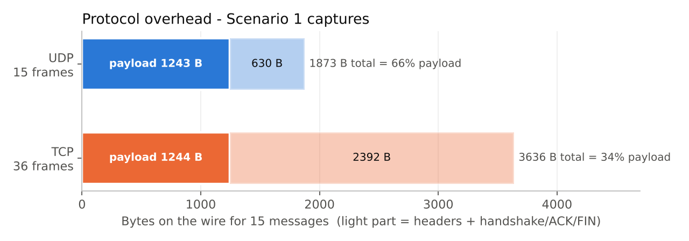

| | |
|---|---|
| **Student** | {{STUDENT_NAME}} |
| **Roll No. / Course** | {{ROLL_NO}} |
| **Repository** | {{REPO_URL}} |
| **Date** | {{DATE}} |

## 1. Purpose

This study compares the TCP and UDP implementations of the Vehicle Monitoring System on the six required parameters. Each statement is backed by a measurement from this project's own runs (see *Validation_Report.pdf* and the `wireshark/` captures).

## 2. Comparison Table

| Parameter | TCP | UDP | Evidence from this project |
|---|---|---|---|
| **Reliability** | Reliable, ordered byte stream. Lost segments are retransmitted, duplicates are removed and data arrives in order. | Best-effort. Datagrams may be lost, duplicated or re-ordered, with no notice to the sender. | 50 000-message burst: **TCP delivered 100 %**, **UDP delivered 80.3 %** (9 862 datagrams silently dropped at the receiver). At 1 Hz for 10 min both delivered 600/600. |
| **Speed** | Extra round trip before the first byte (handshake). Flow and congestion control can slow the sender, and queued data increases latency. | No setup, so the first datagram leaves immediately. The sender is never slowed down. | Burst average latency: TCP 0.562 ms vs UDP 0.106 ms. Handshake cost 20 µs on loopback (about one RTT on a real link). At 1 Hz both were around 0.1-0.2 ms, so the difference is negligible at low rates. |
| **Overhead** | 20-60 byte header (32 B here with timestamps), plus SYN/SYN-ACK/ACK, one ACK per data segment, and FIN/ACK. Kernel keeps per-connection state. | 8-byte header, no control packets, no connection state. | Same 15 messages: **TCP 36 frames / 3 636 B** (34 % payload) vs **UDP 15 frames / 1 873 B** (66 % payload). 10-minute run: TCP 1 206 frames / 130 kB vs UDP 600 frames / 76 kB. |
| **Error Handling** | Built in: checksum, ACK, retransmission, sequence numbers and flow control. Failures surface to the application as errors (`ECONNREFUSED`, `ETIMEDOUT`, `EPIPE`, `ECONNRESET`). | Checksum only; a corrupted datagram is dropped silently. Loss detection, ordering and retries are the application's job. Port-unreachable is reported only via ICMP. | TCP: refused connection, timeout and peer restart all produced explicit errors, and the ECU reconnected automatically. UDP: needed our own sequence numbers to *detect* loss. A non-existent IP (Scenario 4b) was **completely undetectable** at the sender. |
| **Connection Establishment** | Connection-oriented: 3-way handshake (SYN → SYN-ACK → ACK) before data, and FIN-based termination after. | Connectionless: no handshake and no teardown. `connect()` on UDP only sets the default peer and sends nothing. | TCP capture frames 1-3 (handshake) and 34-36 (FIN, FIN/ACK, ACK). UDP capture: the first frame already carries data. |
| **Typical Usage Scenarios** | Data that must arrive complete and in order: file transfer, OTA software updates, diagnostics (DoIP over TCP 13400), configuration, logging, HTTP, MQTT, SSH. | Periodic or real-time data where a newer value replaces a lost one: sensor and signal broadcasts (SOME/IP events over UDP), video/audio streaming, DNS, NTP, service discovery (SOME/IP-SD, DoIP vehicle announcement), multicast. | Vehicle speed, RPM and steering refresh every second. A lost sample is replaced 1 s later, so UDP fits the cyclic stream well. TCP fits commands or configuration sent to an ECU. |

## 3. Additional Differences Observed

| Aspect | TCP | UDP |
|---|---|---|
| Message boundaries | **Not preserved**: byte stream. The Dashboard must reassemble and split on `\n`. | **Preserved**: one `send()` = one datagram = one `recvfrom()`. |
| Receiver absent | `connect()` fails immediately with RST → `ECONNREFUSED` | Datagrams go out; ICMP Port Unreachable comes back; reported on the *next* `send()` of a connected socket |
| Peer crash mid-stream | Next `send()` may still "succeed" (data lost), the one after fails with `EPIPE` | Nothing changes for the sender, apart from optional ICMP errors |
| One-to-many | One connection per receiver | Broadcast / multicast possible |
| Programming effort | More code: connect timeout, retries, reconnect, graceful shutdown, stream framing | Simpler socket code, but loss detection (sequence numbers) is needed in the application |
| Socket calls | `socket, connect, send, shutdown, close` / `socket, bind, listen, accept, recv, close` | `socket, (connect), send` / `socket, bind, recvfrom` |

## 4. Measured Results at a Glance

| Measurement | UDP | TCP |
|---|---|---|
| Scenario 1: frames for 15 messages | 15 | 36 |
| Scenario 1: bytes on the wire | 1 873 | 3 636 |
| Scenario 3: 600 messages / 10 min delivered | 600 (100 %) | 600 (100 %) |
| Scenario 3: average latency | 0.186 ms | 0.105 ms |
| Scenario 5: 20 000 msgs @ 10 kHz delivered | 100 % | 100 % |
| Scenario 5: 50 000-msg burst delivered | 80.3 % | 100 % |
| Scenario 5: burst average latency | 0.106 ms | 0.562 ms |
| Receiver absent: sender notices? | Yes, via ICMP (only if the host is reachable) | Yes, immediately (RST) |
| Wrong but valid IP: sender notices? | **No** | Yes (timeout) |

## 5. Discussion and Recommendation

On a quiet local link at 1 Hz, both protocols are effectively equivalent: 100 % delivery and sub-millisecond latency. The differences appear under stress and under faults.

- **UDP** gives the lowest overhead, never blocks the sender, and preserves message boundaries. These are the properties you want for **cyclic sensor data**: a speedometer is better served by the newest sample than by a delayed retransmission of an old one. The price is that the application must detect loss itself; this project's sequence numbers did that. The sender can also be completely unaware of misconfiguration.
- **TCP** guarantees that every byte arrives in order and turns faults into explicit, actionable errors. The price is roughly 2× the packets, extra latency when data queues, and more code (connection management, reconnect, stream framing).

**Recommendation for this system.** Use **UDP for the periodic vehicle signals** (speed, RPM, steering), with sequence numbers to monitor loss, as automotive SOME/IP event communication commonly does. Use **TCP for anything that must not be lost**: configuration, diagnostic requests, fault logs and software updates.
