<div class="meta">

| | |
|---|---|
| **Student** | {{STUDENT_NAME}} |
| **Roll No. / Course** | {{ROLL_NO}} |
| **Repository** | {{REPO_URL}} |
| **Date** | {{DATE}} |

</div>

## 1. Objective and Test Environment

This report shows that the Vehicle ECU and Dashboard ECU work correctly over UDP and TCP, analyses the traffic in Wireshark, and covers the five required validation scenarios.

| Item | Value |
|---|---|
| OS / kernel | Ubuntu 24.04.5 LTS, Linux 6.x |
| Compiler | GCC 13.3.0 with `-Wall -Wextra -Wpedantic -O2 -std=c11` (builds with **0 warnings**) |
| Analyser | Wireshark / TShark 4.2.2, capture on interface `lo` |
| Network | Loopback 127.0.0.1. Vehicle ECU and Dashboard ECU run as separate processes in separate terminals |
| Ports | UDP 5000, TCP 5001 (scenarios use 51xx-55xx so captures do not mix) |
| Evidence | `screenshots/`, `wireshark/*.pcapng`, full console logs in `logs/` |

## 2. Test Summary

| # | Scenario | Protocol | Expected | Observed | Result |
|---|---|---|---|---|---|
| 1 | Normal communication | UDP | 15/15 messages displayed | 15/15, 0 lost, avg latency 0.182 ms | **PASS** |
| 1 | Normal communication | TCP | Handshake, 15/15 messages, clean close | 15/15, 0 lost, FIN exchange seen, avg 0.136 ms | **PASS** |
| 2 | Dashboard ECU not running | UDP | Sender keeps running, error reported | ICMP Port Unreachable → `ECONNREFUSED` warnings; no crash | **PASS** |
| 2 | Dashboard ECU not running | TCP | Connection refused, retry, controlled exit | SYN → RST,ACK × 3 attempts, exit code 3 | **PASS** |
| 2b | Dashboard stopped / restarted mid-run | TCP / UDP | Sender recovers | TCP: `EPIPE` → automatic reconnect. UDP: resumes when Dashboard returns | **PASS** |
| 3 | Continuous transmission, 10 min | UDP + TCP | No loss, no drift, no errors | 600/600 each, 0 lost, 0 errors, 599.0 s duration (no drift) | **PASS** |
| 4a | Malformed IP (`192.168.1.300`) | UDP / TCP | Rejected before any socket I/O | `[ERROR] Invalid IP address`, exit code 2 | **PASS** |
| 4b | Valid but unreachable IP | TCP / UDP | TCP timeout; UDP cannot detect it | TCP `ETIMEDOUT` after 3 s × 2 attempts; UDP sends with no error | **PASS** |
| 4c | Wrong IP (Dashboard bound to another address) | UDP / TCP | Data not delivered, error visible | Dashboard received 0; ICMP / RST on the wire | **PASS** |
| 5 | TCP vs UDP comparison | both | Measurable difference | Burst of 50 000: UDP delivered 80.3 %, TCP 100 %. TCP uses 2.4× frames | **PASS** |

## 3. Wireshark Traffic Analysis

### 3.1 UDP analysis (`wireshark/udp_capture.pcapng`)

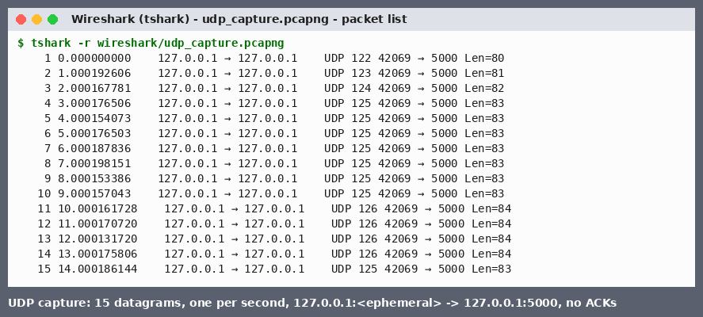

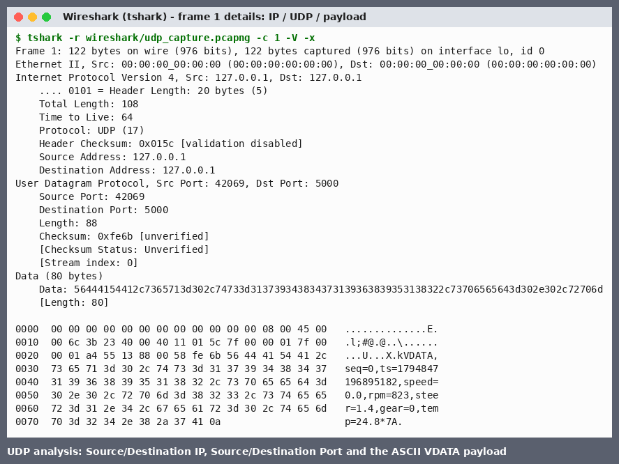

| Field | Value (frame 1) | Notes |
|---|---|---|
| Source IP Address | 127.0.0.1 | Vehicle ECU (loopback) |
| Destination IP Address | 127.0.0.1 | Dashboard ECU |
| Source Port | 42069 | Ephemeral port chosen by the kernel; constant for the whole run |
| Destination Port | 5000 | Dashboard ECU listening port |
| IP protocol | 17 (UDP) | IP header 20 bytes, TTL 64 |
| UDP Length | 88 | 8-byte UDP header + 80-byte payload |
| Payload Data | `VDATA,seq=0,ts=1794847196895182,speed=0.0,rpm=823,steer=1.4,gear=0,temp=24.8*7A\n` | Readable ASCII; matches Dashboard output `[RX 0] Speed 0.0 km/h | RPM 823 | Steer +1.4 deg` |

**Observations.** 15 datagrams, spaced exactly 1.000 s apart, all in one direction. There is no handshake, no acknowledgement and no termination. 122-byte frames carry 80 payload bytes; the rest is headers (14 link + 20 IP + 8 UDP).

### 3.2 TCP analysis (`wireshark/tcp_capture.pcapng`)

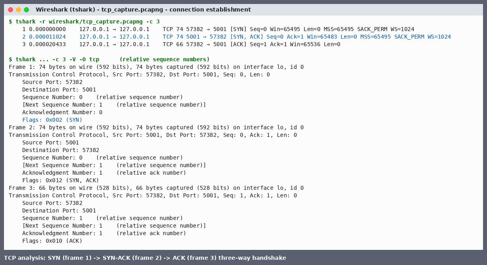

| Frame | Time (s) | Direction | Flags | Seq | Ack | Len | Meaning |
|---|---|---|---|---|---|---|---|
| 1 | 0.000000 | 57382 → 5001 | **SYN** | 0 | - | 0 | Vehicle ECU requests a connection (MSS 65495, SACK, window scale) |
| 2 | 0.000011 | 5001 → 57382 | **SYN, ACK** | 0 | 1 | 0 | Dashboard ECU accepts and acknowledges the SYN |
| 3 | 0.000020 | 57382 → 5001 | **ACK** | 1 | 1 | 0 | Handshake complete; `connect()` and `accept()` return |
| 4 | 0.000055 | 57382 → 5001 | PSH, ACK | 1 | 1 | 81 | **Data transfer**: VDATA seq=0 |
| 5 | 0.000058 | 5001 → 57382 | ACK | 1 | 82 | 0 | Dashboard acknowledges bytes 1-81 |
| 6-33 | 1.0 - 14.0 | ... | PSH,ACK / ACK | ... | ... | 81-83 | One data segment + one ACK per second |
| 34 | 14.000270 | 57382 → 5001 | **FIN, ACK** | 1245 | 1 | 0 | Vehicle ECU `shutdown(SHUT_WR)`: no more data |
| 35 | 14.000381 | 5001 → 57382 | **FIN, ACK** | 1 | 1246 | 0 | Dashboard reads EOF, closes, and acknowledges the FIN in the same segment |
| 36 | 14.000429 | 57382 → 5001 | **ACK** | 1246 | 2 | 0 | Final ACK; connection closed |

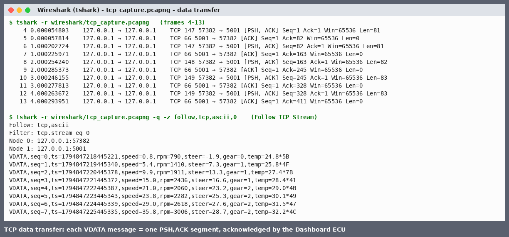

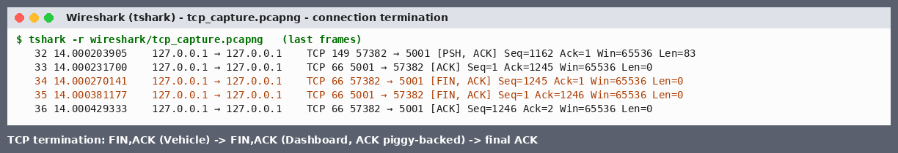

**Observations.**

- *Handshake:* SYN → SYN-ACK → ACK took only 20 µs on loopback.
- *Data transfer:* each `send()` became one PSH,ACK segment. The acknowledgement numbers advance by exactly the payload length (1 → 82 → 163 ...). The final ACK of 1245 equals the 1244 payload bytes reported by both ECUs, plus 1 for the SYN.
- *Termination:* the textbook sequence is FIN → ACK → FIN → ACK (4 segments). Here only **3 segments** appear, because the Dashboard closed immediately after reading EOF. Its ACK of our FIN was therefore piggy-backed on its own FIN. This is normal and is still the 4-way termination logically.
- In total, 36 frames carried 15 messages: 3 handshake, 15 data, 15 ACKs, and 3 termination frames.

## 4. Validation Scenarios

### Scenario 1 - Normal communication

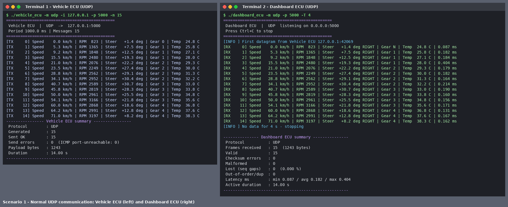

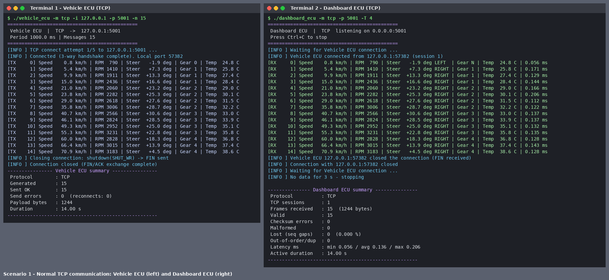

Every `[TX n]` line from the Vehicle ECU has a matching `[RX n]` line at the Dashboard ECU with identical values. The Dashboard adds LEFT/RIGHT steering direction, the gear name (N for neutral) and per-message latency.

| Metric | UDP | TCP |
|---|---|---|
| Messages sent / received / valid | 15 / 15 / 15 | 15 / 15 / 15 |
| Lost / checksum errors | 0 / 0 | 0 / 0 |
| Payload bytes | 1243 | 1244 |
| Latency min / avg / max (ms) | 0.087 / 0.182 / 0.404 | 0.056 / 0.136 / 0.206 |

The 1-byte payload difference is not an error: values are random, so one TCP message had one more digit.

### Scenario 2 - Dashboard ECU not running

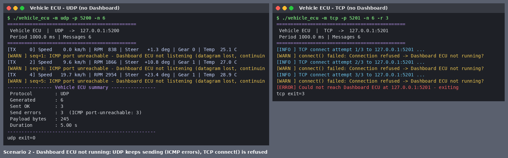

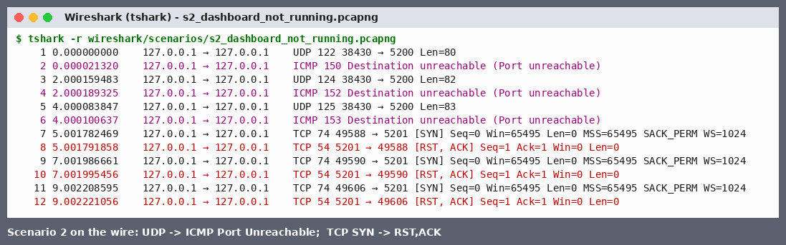

**UDP.** The Vehicle ECU cannot know in advance whether anyone is listening; it simply sends. The host answers each datagram with **ICMP Destination Unreachable (Port Unreachable)**. Because the UDP socket is connected, the kernel reports that ICMP error on the *next* `send()` as `ECONNREFUSED`, and that sample is not sent. This produces the alternating pattern in the log (seq 0 sent, seq 1 error, seq 2 sent, ...): 3 sent, 3 errors. The ECU never stops. This is correct behaviour for a broadcaster of periodic data.

**TCP.** `connect()` sends a SYN. With no listener, the kernel immediately answers **RST, ACK**, and `connect()` fails with `ECONNREFUSED`. The Vehicle ECU retries three times (2 s apart, visible as three SYN/RST pairs at t = 5, 7 and 9 s), then exits with code 3 and a clear message. **No data is ever sent without a connection.**

#### Scenario 2b - Dashboard ECU stopped and restarted during transmission

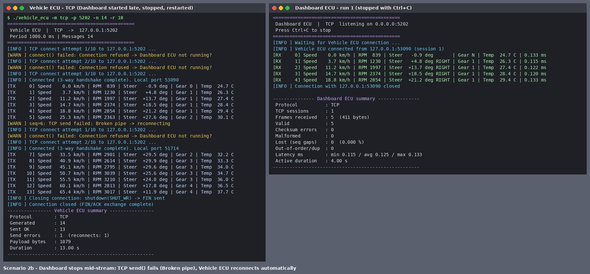

- **TCP** (`s2b_dashboard_restart.pcapng`): the Vehicle ECU starts first, and its two connection attempts are refused. The Dashboard starts and the 3rd attempt succeeds. After 5 messages the Dashboard is stopped with Ctrl+C, and its FIN arrives (frame 18).
  - The Vehicle ECU's next `send()` *succeeds locally*, but the closed peer answers with **RST** (frame 21). That message (seq 5) is lost even though `send()` returned success.
  - The following `send()` fails with `EPIPE` (Broken pipe), and the Vehicle ECU reconnects automatically. One refused attempt follows; the next succeeds once the Dashboard is back. The remaining 7 messages are delivered, followed by a clean FIN exchange.
  - **Lesson:** a successful TCP `send()` only means the data reached the local kernel buffer. It does not mean the application on the other side received it.
- **UDP:** while the Dashboard was down, samples seq 5-8 were lost. Seq 5 and 7 were sent and answered with ICMP Port Unreachable; the sends of seq 6 and 8 then returned `ECONNREFUSED`. When the Dashboard restarted it received seq 9 onward, with no reconnection needed.

### Scenario 3 - Continuous transmission for an extended duration

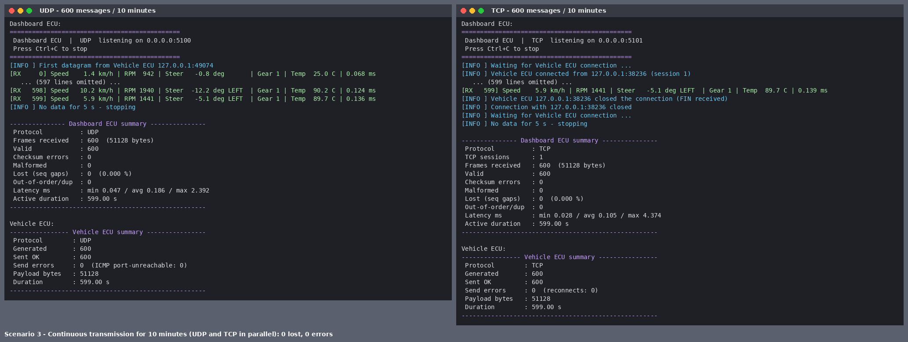

Both protocols ran **in parallel for 10 minutes** (600 messages at 1 Hz, ports 5100/5101, capture `s3_long_run.pcapng`).

| Metric | UDP | TCP |
|---|---|---|
| Sent / received / valid | 600 / 600 / 600 | 600 / 600 / 600 |
| Lost / out-of-order / checksum errors | 0 / 0 / 0 | 0 / 0 / 0 |
| Send errors / reconnects | 0 | 0 / 0 |
| Duration for 600 messages | 599.00 s | 599.00 s |
| Latency min / avg / max (ms) | 0.047 / 0.186 / 2.392 | 0.028 / 0.105 / 4.374 |
| Frames on the wire | 600 | 1206 |
| Bytes on the wire | 76 kB | 130 kB |
| TCP retransmissions | - | 0 |

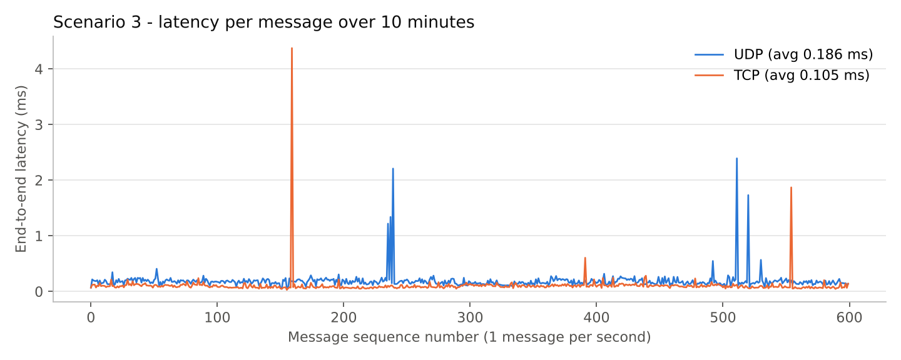

**Observations.**

- The transmit period stayed exact: 600 messages took 599.00 s, i.e. 599 intervals of 1 s. This is because the sender sleeps until an *absolute* deadline (`clock_nanosleep` with `TIMER_ABSTIME`) instead of sleeping 1 s after each send, which would accumulate drift.
- Memory and CPU stayed flat. Latency stayed well below 1 ms, apart from isolated spikes of 2-4 ms caused by operating-system scheduling.
- TCP needed twice as many frames as UDP, because every data segment was acknowledged.

### Scenario 4 - Invalid IP address configuration

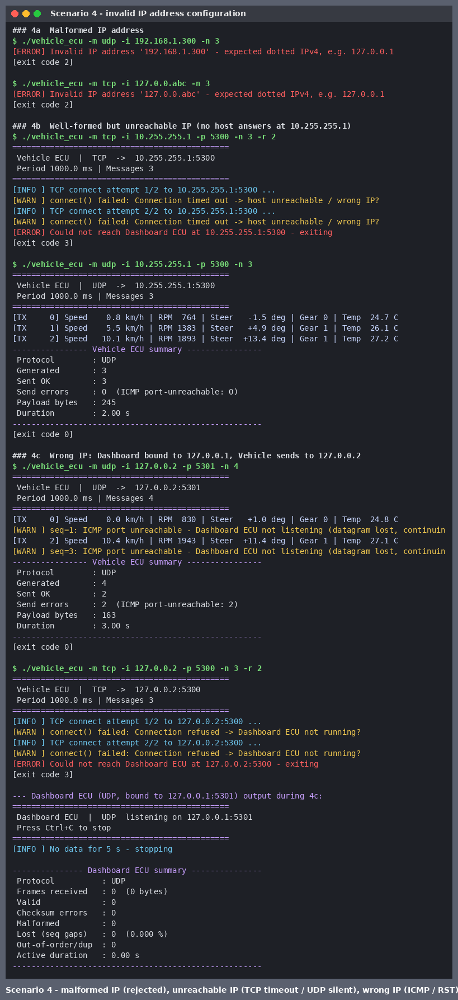

| Case | Input | UDP behaviour | TCP behaviour |
|---|---|---|---|
| 4a. Malformed address | `192.168.1.300`, `127.0.0.abc` | `inet_pton()` rejects it: `[ERROR] Invalid IP address`, exit 2. Nothing is sent. | Same |
| 4b. Valid format, no host at that address | `10.255.255.1` | All 3 datagrams "sent OK"; **the error is undetectable** because nothing answers | SYN retransmitted, no reply, `ETIMEDOUT` after 3 s per attempt; exit 3 after 2 attempts |
| 4c. Wrong host address (Dashboard bound to 127.0.0.1, sender uses 127.0.0.2) | `-i 127.0.0.2` | ICMP Port Unreachable → warnings; Dashboard receives **0** messages | RST → `ECONNREFUSED`; exit 3 |

*Note on case 4b:* in the test environment the upstream router actively rejected traffic to unknown hosts. A temporary host firewall rule was therefore used to drop replies from `10.255.255.1`, emulating the usual LAN case where nobody owns the address. The capture `s4c_wrong_ip.pcapng` contains case 4c only.

**Conclusion.** The most dangerous misconfiguration is 4b with UDP: the sender believes everything is fine. Only the receiver (no data, or sequence gaps) or an application-level acknowledgement can reveal it. TCP turns the same mistake into an immediate, explicit error.

### Scenario 5 - Comparison between TCP and UDP implementations

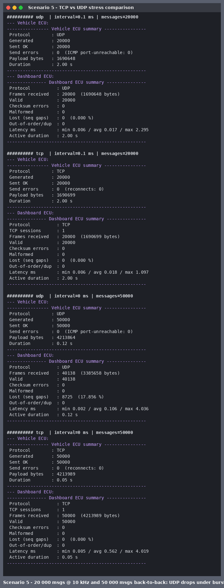

Besides the 1 Hz runs above, both implementations were stressed on the same host:

| Test | Metric | UDP | TCP |
|---|---|---|---|
| 20 000 msgs @ 0.1 ms (10 kHz) | Delivered | 20 000 (100 %) | 20 000 (100 %) |
| | Avg / max latency (ms) | 0.017 / 2.295 | 0.018 / 1.097 |
| 50 000 msgs back-to-back (no delay) | Sender duration | 0.12 s | 0.05 s |
| | Delivered | **40 138 (80.3 %)** | **50 000 (100 %)** |
| | Lost | 9 862 (8 725 detected as sequence gaps + 1 137 at the end of the burst) | 0 |
| | Avg / max latency (ms) | 0.106 / 4.036 | 0.562 / 4.019 |

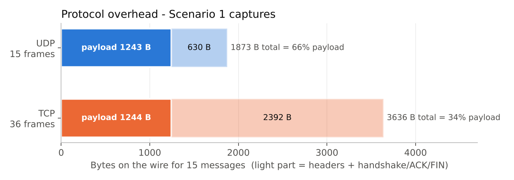

**Observations.**

- At realistic rates (1 Hz, and even 10 kHz) both protocols delivered 100 % on a local link.
- Under an unthrottled burst, the Dashboard's UDP receive buffer overflowed and the kernel **silently discarded about 20 % of the datagrams**. The sender reported no error, because UDP has no flow control.
- TCP's flow control (receive window) slowed the sender down instead, so nothing was lost. The cost is higher average latency (0.56 ms vs 0.11 ms), because data queued in socket buffers.
- The Dashboard counts loss from sequence gaps. Messages lost at the very *end* of a burst leave no gap behind them, so the dashboard reported 8 725 and the true loss (50 000 − 40 138) is 9 862. A real system would add a periodic heartbeat or an expected-count check to catch this.
- Overhead: for the same 15 messages, UDP put 1 873 bytes on the wire (66 % payload) and TCP put 3 636 bytes (34 % payload), because of the handshake, per-segment ACKs, termination and the larger TCP header (32 bytes with timestamps vs 8 bytes).

The full qualitative comparison is in **TCP_UDP_Comparison.pdf**.

## 5. Conclusion

Both implementations meet every functional requirement. The Wireshark analysis confirmed:

- UDP: correct source/destination addresses, ports and payload.
- TCP: complete SYN / SYN-ACK / ACK establishment, acknowledged data transfer, and orderly FIN termination.

The validation scenarios show the defining trade-off. **UDP** is lighter and never blocks, but loss and misconfiguration are invisible to the sender. **TCP** guarantees ordered, complete delivery and reports failures explicitly, at the cost of twice the packets and connection-management logic. The applications handle every tested fault (missing receiver, peer restart, bad IP) without crashing, and they report a clear diagnostic in each case.

## Appendix - Reproducing the tests

```bash
cd src && make
sudo tshark -i lo -f "udp port 5000" -w ../wireshark/udp_capture.pcapng   # or use the Wireshark GUI on 'Loopback: lo'
./dashboard_ecu -m udp -p 5000 -T 4 &   ./vehicle_ecu -m udp -p 5000 -n 15
./dashboard_ecu -m tcp -p 5001 -T 4 &   ./vehicle_ecu -m tcp -p 5001 -n 15
./vehicle_ecu -m tcp -p 5201 -n 6 -r 3                       # Scenario 2 (no dashboard)
./vehicle_ecu -m udp -i 192.168.1.300                        # Scenario 4a
./dashboard_ecu -m udp -p 5500 -q -T 2 & ./vehicle_ecu -m udp -p 5500 -n 50000 -t 0 -q   # Scenario 5
```
